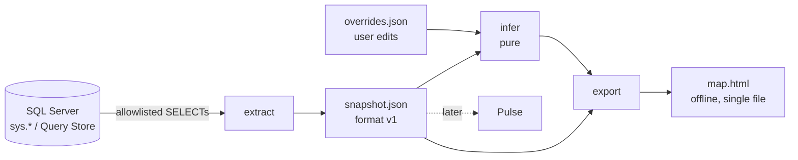

# Architecture

Status: draft for gate 0 review (crumb 0.9). Decisions referenced as D-nnn live in
[DECISIONS.md](DECISIONS.md).

Schema Map reads system metadata from one SQL Server database through a read-only login,
writes a **snapshot** (a JSON document), infers undeclared relationships from it, and exports
an offline single-file HTML **map**. The snapshot is the contract between every stage.

## 1. Principles

1. **Metadata only, read-only.** Only `sys.*`, `INFORMATION_SCHEMA`, Query Store views and DMVs
   are queried, only with `SELECT`, and only through an allowlisting executor.
2. **The snapshot is the boundary.** Only `connect` and `extract` see the database. Everything
   downstream (infer, export, viewer, later Pulse) works from snapshot files, so it is testable
   without a server and reproducible from a file someone sends you.
3. **Pure where possible.** Inference is a pure function of a snapshot (plus user overrides).
4. **Local.** No network except opt-in telemetry.
5. **Deterministic.** The same database state yields byte-identical snapshot files, apart from
   `captured_at`.

## 2. Modules

```
cli/src/schemamap/
  cli.py          Typer app. The only place that prints (Rich), parses flags, maps errors
                  to exit codes, reads credentials from a prompt or environment variables.
  errors.py       Typed error hierarchy (section 6).
  connect/        Opens a connection (ApplicationIntent=ReadOnly where supported) and exposes
                  a MetadataExecutor that runs only queries from queries/.
  queries/        Every SQL statement, one .sql file each, loaded by name. The allowlist
                  test parses each file: SELECT only, system objects only.
  extract/        Runs queries section by section, maps rows to snapshot models, records
                  warnings for skipped sections, parses SQL text into join evidence.
  snapshot/       Pydantic models (format v1), IDs, JSON I/O, redaction, JSON Schema.
  infer/          Pure functions: Snapshot (+ overrides) -> inferred relationships.
  export/         Builds the HTML map: viewer bundle + snapshot JSON inlined safely.
  telemetry/      Opt-in, count-only. The only module allowed to open a socket.
viewer/           React + TypeScript app built into one HTML file; reads the inlined JSON.
schema/           snapshot.v1.json, generated from snapshot/ and committed.
```

Allowed imports (enforced by review now, by an import-linter test once the modules exist):

```
cli ──> connect, extract, infer, export, telemetry, snapshot, errors
extract ──> connect, queries, snapshot, errors        (sqlglot for parsing)
infer ──> snapshot, errors                            (no connect, no I/O)
export ──> snapshot, infer, errors                    (no connect)
telemetry ──> errors                                  (never snapshot contents)
snapshot ──> errors                                   (leaf)
```

The SQL Server driver is chosen in a later crumb. It is hidden behind `MetadataExecutor`:

```python
class MetadataExecutor(Protocol):
    def run(self, query: QueryName, params: Mapping[str, str | int]) -> Iterator[Row]: ...
```

`QueryName` is an enum of files in `queries/`, so arbitrary SQL cannot even be expressed.
The executor checks the file against the allowlist again before executing it.

## 3. Data flow



Typical run: `schemamap scan` = connect → extract → write snapshot → infer → export.
Each stage can also run alone (`extract` to a file, `export` from a file), which makes bug
reports reproducible: a user can send a (redacted) snapshot instead of database access.

### Extract, section by section

Each section (schemas, tables, views, routines, synonyms, relationships, dependencies,
definitions, descriptions, row counts, query history, join evidence) is independent. If a
section's query fails with a permission error, extract records one `ExtractionWarning`
(`section`, `code`, `message`) and carries on. Partial snapshots are normal and are labelled.

### Why parsing happens in extract and infer stays pure

Join evidence comes from SQL text: module definitions and, optionally, Query Store query text.
Query text can contain literals copied from rows, so it never enters the snapshot. That means
the only stage that ever holds it is extract, so extract parses it (sqlglot), keeps only
**typed column pairs with counts**, and throws the text away. Module definitions are parsed
there too so all join evidence has one source, one parser and one shape.

Infer then reads `join_evidence` as plain data. Keeping infer pure means it has no database,
clock, network or parser dependency, it is deterministic, it can be unit-tested with
hand-written snapshots, and re-running inference with new overrides or a better scoring model
never needs database access again.

## 4. Snapshot format v1

Defined in `cli/src/schemamap/snapshot/models.py`; the published contract is
`schema/snapshot.v1.json` (JSON Schema 2020-12), generated by
`cd cli && uv run python scripts/gen_snapshot_schema.py`. A test fails if the committed file
is stale. Viewer TypeScript types are generated from that file, never hand-written.

```
Snapshot
  format              "schemamap.snapshot"
  format_version      "1.0"
  generator           {name, version}
  captured_at         UTC timestamp
  source              {server | null, server_redacted, database, product_version,
                       engine_edition, compatibility_level, collation}
  schemas[]           {id, name, description}
  tables[]            {id, schema_id, name, description, columns[], indexes[],
                       key_constraints[], check_constraints[]}
  views[]             {id, schema_id, name, columns[], definition, definition_status, ...}
  routines[]          {id, schema_id, name, kind, parent, definition, definition_status}
  synonyms[]          {id, schema_id, name, target: Reference}
  relationships[]     declared foreign keys: {id, name, edge, from_object, from_columns[],
                       to_object, to_columns[], on_delete, on_update, disabled, trusted}
  dependencies[]      {from_object, target: Reference}
  warnings[]          {section, code, message}
  row_counts          OPTIONAL {items[]: {object, rows}}
  query_history       OPTIONAL {source, window_start, window_end,
                                items[]: {object, execution_count, last_executed_at}}
  join_evidence       OPTIONAL {entries[]: {from_column, to_column, source, count},
                                parse_failure_count}
  inferred_relationships   RESERVED for v1.1, not in v1
```

### Design constraints and how they are met

| Constraint | Mechanism |
|---|---|
| No row data | Every field has a concrete type: no `Any`, no open dicts, no bytes. A test walks every model field, another walks the JSON Schema. Free text is limited to names, descriptions and SQL definitions (see below). |
| Deterministic | Unordered lists are sorted by ID (or by canonical content) on validation and duplicates are rejected. Ordered lists (columns by ordinal, key columns) keep catalog order. Fixed field order, indent 2, trailing newline. |
| Forward compatible | Readers ignore unknown fields. Minor versions only add optional fields or sections. |
| Cross-database | `Reference.scope` is `local`, `cross_database` or `cross_server`. Only local references get `resolved`; others keep the name exactly as written and are never followed. |
| Optional sections | `row_counts`, `query_history`, `join_evidence` are `null` when not collected, which is distinct from an empty list (collected, nothing found). |
| No credentials | No field can hold a login, password, token or connection string; a test rejects such field names. `--redact-server` drops `source.server` and every linked-server name. |
| Integrity | Validation checks that every referenced object and column exists and that columns, indexes and objects belong to their parent. |

### Definitions are free text

View, routine, computed column, default, check and filtered-index definitions are stored by
default because they drive dependency and join evidence and are what users want to read.
They are metadata, but they are free text written by developers and **may contain literals**
(for example `WHERE Status = 'VIP'` or a hard-coded email address). This is documented in
SECURITY.md. A future `--no-definitions` flag will omit them, adding an `omitted` value to
`definition_status` in a v1.x minor release. Today `definition_status` tells the viewer why a
definition is missing: `encrypted`, `not_permitted` or `not_applicable`.

### Join evidence

Each entry says "columns A and B were compared by equality in a join" with a `source`
(`code` for module definitions, `query_history` for Query Store) and a `count` of distinct
modules or queries. Pairs are unordered, so they are stored with `from_column < to_column`.
`parse_failure_count` records statements the parser could not read, so infer can tell
"no evidence" from "evidence unavailable". No SQL text is stored anywhere in this section.

## 5. Object IDs

Every entity has a stable, readable, reversible ID: `<kind>:<body>`.

| Kind | Example | Scope rule |
|---|---|---|
| `schema` | `schema:dbo` | unique per database |
| `object` | `object:dbo.Orders` | tables, views, routines, synonyms share one namespace per schema |
| `column` | `column:dbo.Orders.CustomerId` | unique per table or view |
| `index` | `index:dbo.Orders.IX_Orders_Date` | index names are unique per table |
| `constraint` | `constraint:dbo.PK_Orders` | PK, unique, check, default; unique per schema |
| `foreign_key` | `foreign_key:dbo.FK_Orders_Customers` | unique per schema |
| `edge` | `edge:dbo.Orders(CustomerId,TenantId)>dbo.Customers(Id,TenantId)` | derived from ordered columns |

**Escaping.** Each name part is percent-encoded (uppercase hex, UTF-8) for `%`, the delimiters
`. ( ) , >` and control characters only. Everything else, including Unicode, quotes, brackets,
spaces and `<`, is kept verbatim and is not normalized (`é` and `e`+combining accent are
different names in SQL Server, so they get different IDs). Example: a table named `a.b]` is
`object:dbo.a%2Eb]`.

**Canonical form.** The parser accepts only what the builders produce: no lowercase hex, no
escaping of characters that need none, no empty parts. So each name has exactly one ID, and
`parse(id).to_id() == id`. A property test checks round-trip, canonical form and injectivity
for every kind, plus fixed hostile names (`a.b]`, `x'; DROP`, `</script>`, `%2E`, RTL, emoji,
control characters).

**Edges.** A relationship's identity is its column mapping, not its constraint name. The edge
ID is built from the ordered from-column IDs and to-column IDs, so `overrides.json` can say
"reject edge X" or "confirm edge X" and that keeps working when a constraint is renamed, and
an inferred edge and a later-declared key with the same columns have the same edge ID.
Two foreign keys with identical columns share an edge (their `foreign_key` IDs still differ).

**Rendering.** IDs and names are untrusted text. The viewer renders them as text, never HTML;
export escapes `<`, `>`, `&`, U+2028 and U+2029 when inlining JSON.

## 6. Error model

```
SchemaMapError
  InvalidIdError        malformed or non-canonical ID (also a ValueError)
  SnapshotError         unreadable snapshot file
    SnapshotVersionError  unsupported format major version
  ConnectError          (crumb 1.x) cannot connect or authenticate
  QueryRefusedError     (crumb 1.x) SQL not in the allowlist: a bug, never user-facing input
  PermissionMissing     (crumb 1.x) raised inside extract for one section, caught there and
                        turned into an ExtractionWarning; never escapes extract
```

Rules: library code raises typed errors and never prints or exits. Messages never include
credentials or connection strings. The CLI maps errors to exit codes:

| Exit | Meaning |
|---|---|
| 0 | success (possibly with warnings, which are printed and stored in the snapshot) |
| 1 | unexpected internal error (bug; traceback only with `--debug`) |
| 2 | usage error (Typer default) |
| 3 | cannot connect or authenticate |
| 4 | invalid or unsupported snapshot file |

## 7. Versioning

* **Package version** (`schemamap --version`) follows SemVer and is independent of the format.
* **`format_version` is `MAJOR.MINOR`.** A minor bump only adds optional fields, sections or
  enum values; a v1.0 reader can read any v1.x file and simply ignores what it does not know.
  A major bump is a breaking change and gets a new `schema/snapshot.v2.json`.
* Readers check the major version first and fail with `SnapshotVersionError` on a mismatch.
* Writers always emit the newest minor they know.
* **Enum growth caveat:** a new enum value is a minor change, but a strict v1.0 validator will
  reject it. The viewer therefore treats unknown enum values as "other" rather than failing.

### Planned v1.1: inferred relationships

v1.1 adds a top-level `inferred_relationships` list: `{edge, from_columns, to_columns, score,
evidence[]}`, with typed evidence entries (name match, type match, join evidence counts,
index presence). It is deliberately **not** merged into `relationships`: a v1.0 viewer ignores
the unknown list, so it can never present a guess as a declared key (D-017). The name is
reserved in the v1 schema description.

## 8. How Pulse extends this

Pulse (query performance from Query Store) is a later, separate module:

* **Own queries.** Pulse adds its own `.sql` files under `queries/` (Query Store views and
  DMVs only) and they pass the same allowlist test. No new execution path.
* **Own artifact.** Pulse writes its own file (for example `pulse.json`) with its own format
  and version, keyed by snapshot object IDs. It does not widen the snapshot: Map stays small,
  free and metadata-only, and Pulse can evolve on its own release cycle.
* **Query text policy.** Pulse needs query text and plans, which can contain literals. Pulse
  will normalize and strip literals before storage, keep it local, and be opt-in per run.
  That policy is designed in Pulse's own crumb; the snapshot never holds query text.
* **Shared pieces.** Pulse reuses `connect`, the executor, IDs and the error model, and the
  viewer can overlay Pulse data on the map by object ID.
* The snapshot's optional `query_history` (execution counts per object) and `join_evidence`
  stay in Map because they feed the map directly (usage heat, inference).

## 9. Telemetry

Opt-in only, off by default, count-only (D-006): command name, tool version, success or
failure category, object counts in buckets. Never names, IDs, server, database or snapshot
contents. It is the only module allowed to make a network call, and it is one small module
so it is easy to audit.

## 10. Security summary

* Credentials: prompt or environment variables only; never logged, stored or in a snapshot.
* Read-only connection plus allowlisted SELECT-only queries over system objects.
* Snapshots and maps stay local; `--redact-server` for sharing.
* Hostile object names are handled by escaped IDs, text-only rendering and safe JSON inlining.
* Definitions may contain literals (section 4); `--no-definitions` is planned.
