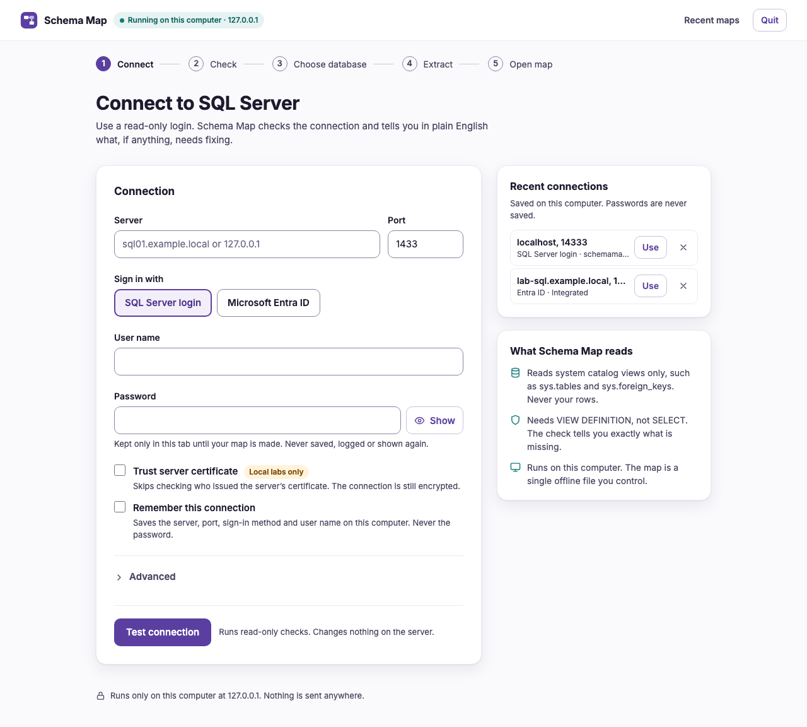
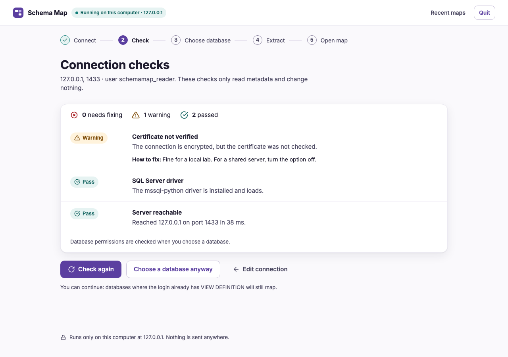
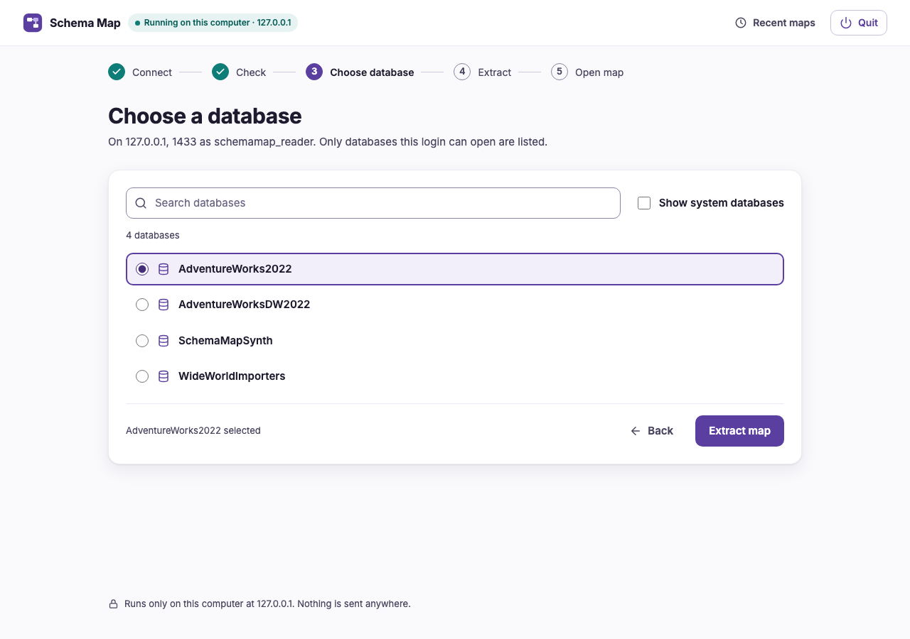
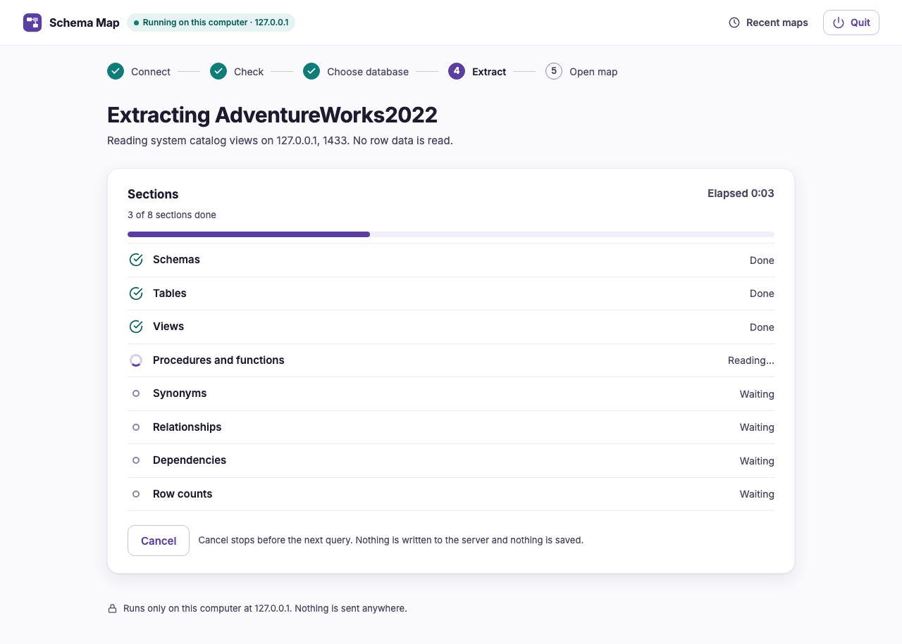
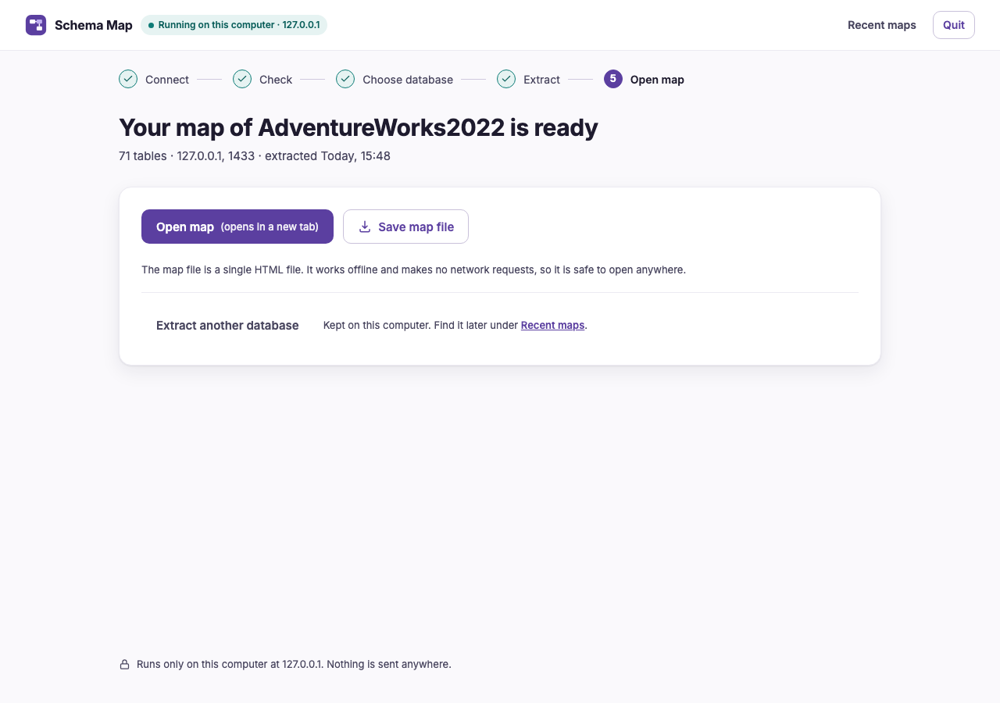
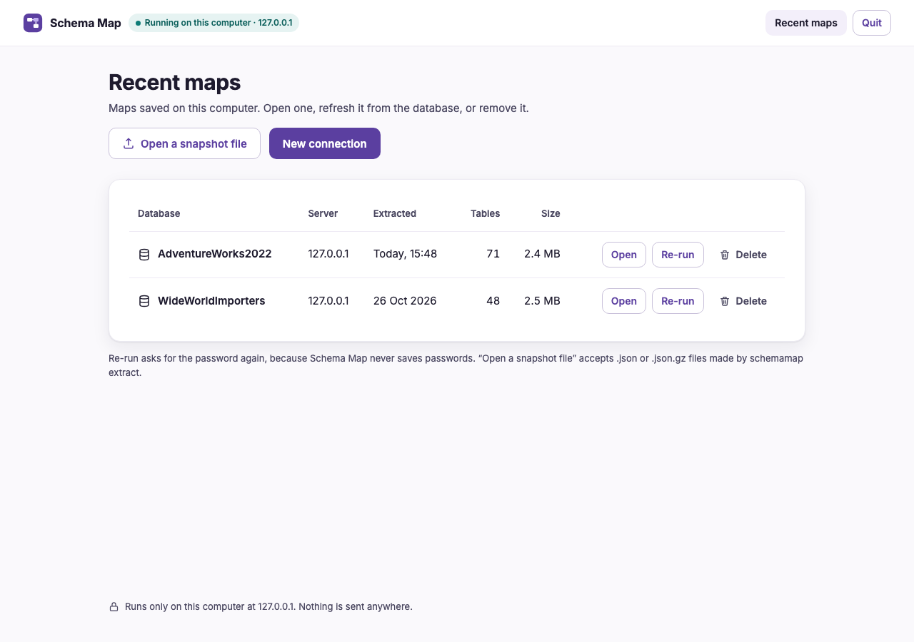

# Schema Map UI: the local launcher

`schemamap ui` starts a small HTTP server on the user's own machine and opens the browser at the
launcher: connect, check, pick a database, extract, open the map. The CLI stays for scripts. The
map file it produces is the same offline file `schemamap view` writes (D-057).

Status: built through U.6 (server, connection API, jobs and library, and the launcher screens:
connect, check, pick, extract, done, recent maps, quit; checked on Windows, macOS and Linux in
CI) and reviewed in U.7 (`docs/gates/PHASEU.md`). Plan and non-negotiables:
`docs/plans/PHASE_U.md`. Review amendments to U.0 are in D-060.
Sections 1 to 4 below are the technical contract; the next section is for people using it.

## Using the launcher

Screenshots are of the launcher at 1280 px wide with made-up connection details; nothing in them
is real data.

### Start it

```
schemamap ui
```

The terminal prints one line, `Schema Map is running at http://127.0.0.1:<port>/#c=<code>`, and
your browser opens at it. The page only answers your own computer. The link works once and
expires after a minute; if you closed the tab or waited too long, press Ctrl+C and run
`schemamap ui` again. Use `--no-open` to print the link without opening a browser, `--port` to
choose the port, and `--data-dir` to keep your maps somewhere else.

The first Tab stop on every screen is a **Skip to main content** link (it appears when it has
focus). The whole flow works from the keyboard.

### 1. Connect



Enter the server (a name or an address), the port if it is not 1433, and how to sign in:

- **SQL Server login:** a user name and password. Use a read-only login.
- **Windows:** shown only on Windows. It uses the Windows account you are signed in with, so
  there is no user name or password to type.
- **Microsoft Entra ID:** the methods Schema Map supports are listed on the screen.

Tick **Remember this connection** to keep the server, port, sign-in method and user name for
next time. The password is never saved, logged or shown again. **Trust server certificate** is
for local labs with a self-signed certificate; leave it off for a real server.

### 2. Check



**Test connection** runs read-only checks and lists each one as pass, warning or fail, with what
to do about it. If a permission is missing, the screen gives a short SQL script with a **Copy
script** button to send to whoever manages the server. Schema Map needs `VIEW DEFINITION`, not
`SELECT` on your tables.

### 3. Choose a database



Pick the database to map. The search box narrows a long list. Choosing a database also checks
that login's permissions in that database.

### 4. Extract



Schema Map reads the database's metadata, section by section, and shows the time so far. Cancel
stops it and keeps nothing. If it fails, the screen says why and what to change.

### 5. Open the map



**Open map** opens it in a new tab. **Save map file** downloads the single offline `.html` file
to share or keep. **Extract another database** goes back to the picker.

### Recent maps



Every map is kept in the data folder. From **Recent maps** (top bar) you can open one, re-run its
extract, delete it (after a confirmation), or add a snapshot file you already have.

**Re-run** asks only for the password when the connection is known: the server you are connected
to now, or one you ticked **Remember this connection** for. Otherwise it says so and takes you
to Connect with the server filled in.

### Where your files are

| System  | Default folder              |
| ------- | --------------------------- |
| Windows | `%USERPROFILE%\SchemaMap`   |
| macOS   | `~/SchemaMap`               |
| Linux   | `~/SchemaMap`               |

User names with spaces or accents are fine (`C:\Users\Zoë Müller\SchemaMap`). The folder holds
your maps and the list of remembered connections, and nothing leaves it. Delete the folder to
remove everything Schema Map saved.

### Stopping

Press **Quit** in the top bar, or Ctrl+C in the terminal. It also stops by itself after 30
minutes without use. If an extract is running, stopping cancels it first, which can take a few
seconds; pressing Ctrl+C again does not cut that short.

Stopping also ends an upload that is in flight and empties the `tmp/` folder inside the data
folder, after waiting up to five seconds for a write that has already begun. On Windows an open
file cannot be deleted, so in rare cases a file may be left in `tmp/`; it is removed the next
time `schemamap ui` starts. The `ui-smoke` job quits with an upload in flight on all three
systems and checks this.

### If something goes wrong

- **"This link has already been used or has expired":** run `schemamap ui` again.
- **"Cannot listen on 127.0.0.1 port ...":** another program has that port. Leave out `--port`.
- **"The launcher page is not built":** you are running from a checkout; see the README.
- **A check fails:** the screen names the fix. `schemamap doctor` shows the same checks.

## 1. Architecture

```
browser tab (launcher page, http://127.0.0.1:<port>/)
   │  fetch /api/*  + X-SchemaMap-Token header
   ▼
schemamap.ui.server   ThreadingHTTPServer on 127.0.0.1:<random>, one thread per request
   ├─ security.py     Host, Origin, Sec-Fetch-Site, launch code, token (small, pure, clock-injected)
   ├─ datadir.py      the data folder: default per OS, created 0700
   ├─ assets.py       packaged launcher page + its Content-Security-Policy
   ├─ jobs.py         (U.3) one extract job at a time, in a worker thread
   ├─ library.py      (U.3) maps on disk: list, serve, download, delete, import
   ├─ api.py          (U.2) connection routes as plain functions: parsing, test, database list
   └─ connections.py  (U.2) remembered connections, never a password
        │
        ▼
schemamap.connect / extract / viewer   the same allowlisted query layer and map embedding as the CLI
```

- **Server stack:** standard library `http.server` with `ThreadingHTTPServer` (D-058). No new
  runtime dependency.
- **Bind:** always `127.0.0.1`, port 0 (the OS picks a free port; U.1 adds `--port`). The
  address is a constant with no parameter, so nothing can bind `0.0.0.0` by accident.
- **CLI layer:** the `ui` command in `cli.py` loads the launcher, creates the data folder,
  starts the server, prints the launch link on one stdout line and the data folder on stderr,
  opens the browser (`ui/browser.py`: only `http` and `file` URLs without whitespace or control
  characters, handed to `webbrowser.open` as one argument, never a shell command), and stops
  on Ctrl+C, SIGTERM, `POST /api/quit` or 30 minutes without use. Library modules never print.
- **Stopping (U.7, D-069):** while the server runs, SIGINT and SIGTERM call
  `request_stop("interrupt")` instead of raising `KeyboardInterrupt`, so a second Ctrl+C (or
  the copy `uv run` forwards) cannot interrupt `server_close`: it cancels the job, waits up to 5
  seconds for it, cuts short any upload in flight (its connection is shut down so the handler
  closes its file), waits up to 5 seconds for writes that have begun (`MapLibrary.close`), and
  empties `tmp/`; a file Windows still holds is removed at the next start (#13). If the job's query is still running after that wait, the
  command reports the stop and ends the process with `os._exit(0)`, because a normal exit would
  run the SQL Server driver's exit hook, which closes the connection under the running query
  and crashes the process.
  Options: `--port` (default: the OS picks), `--no-open`, `--data-dir`.
- **Idle timeout:** the timer restarts on every successful (2xx) response, so refused or
  unauthenticated requests cannot keep the launcher alive. After 30 minutes without one the
  server stops and says so. The clock is injectable, so the tests do not wait.
- **Logging:** none. The handler's `log_message` and the server's `handle_error` are silenced,
  so request lines, headers and tracebacks (which could quote request data) never reach the
  terminal or a file.
- **Request handling order:** Host → Origin → route. For `/maps/<id>`: method →
  `Sec-Fetch-Site` → id. For `/api/*`: token → route → method → body limits → handler.
  Unknown `/api/*` paths need the token before they answer 404, so nobody without it can map
  the API. `POST /api/session` is the one `/api/*` route without the token: it takes the launch
  code instead (below), and still passes Host, Origin, method and body checks.
- **Body rules** (`POST`, `PUT`, `PATCH`): `Content-Length` is required (411; chunked bodies are
  refused), judged before anything is read (413 over 1 MB), `Content-Type` must be
  `application/json` (415), and the body must be a JSON object (400). A refused request's
  connection is closed, so an unread body is never mistaken for the next request.

### Launch link and session (D-060)

The launch link is `http://127.0.0.1:<port>/#c=<code>`. The code is random (256 bits), valid for
60 seconds from the moment the server starts, and works once. The page removes the fragment from
the address bar, `POST`s the code to `/api/session`, and receives the session token in the
response body. It keeps the token in `sessionStorage` and sends it as a header on every API
call. A used, expired or wrong code is `401`; a wrong guess does not use the real code up. The
token itself is never in any URL, so the browser-launch process's arguments, the terminal and the
browser's history database only ever hold a code that is already worthless.

A reload of the tab keeps working from `sessionStorage`. Closing the tab, or opening another
profile, needs a new link: restart `schemamap ui`.

### Job model (U.3)

- One job at a time; a second `POST /api/jobs` gets `409 job_running`, and the error carries `job_id`, the id of the extract that is running, so a second tab can follow its progress.
- A job runs `extract_snapshot` in a worker thread. The extract pipeline reports progress through
  a callback (the CLI's progress bar uses the same one). The job records per-section state:
  `pending | running | done | skipped | failed`. A section's count (items read) is filled in when
  the job ends in `done`; while it runs the page shows which section is being read.
- Job states: `running → done | failed | cancelled`. Cancel is cooperative: it is checked between
  sections and before every query (the executor's gate), and the query timeout bounds the wait for
  the query in flight. The state stays `running` until the job reaches its next check.
- **Password lifetime:** the request body is parsed into a connection config; the password is
  used to open the connection and then the job drops its reference. Python cannot scrub memory,
  so "dropped" means no reference is kept and nothing writes it anywhere. It is never logged,
  never put in an error (a failed login is masked by value with `redact()` while the config is
  still held; after that the job keeps no secret, so extract-phase messages are fixed wording and
  still have `PWD=`/`Password=` fragments masked), never echoed in a response, and never on any
  command line.
- Finished jobs are kept in memory for the life of the server (status only, no credentials).

### Where files go

`<data-dir>` defaults to `~/SchemaMap` on macOS and Linux and `%USERPROFILE%\SchemaMap` on
Windows (U.1, `--data-dir`). It is created with mode 0700, and files are written 0600 with the
existing atomic writer (`write_bytes_atomic`).

```
<data-dir>/
  connections.json        remembered connections: server, port, database, auth mode, user. No password field.
  maps/<id>/
    snapshot.json.gz      the snapshot
    map.html              the map, byte-identical to `schemamap view` output for that snapshot
    meta.json             database, server (as shown), extracted_at, table count, size
  tmp/                    uploads and in-progress writes; emptied at start and at shutdown
```

`<id>` is 32 lowercase hex characters from `secrets.token_hex(16)`. It is generated, never
taken from a user path, and looked up in the library index. Request input is never joined into
a filesystem path.

### Front end and packaging (D-059)

- The source lives in `viewer/`, as a second entry: `viewer/launcher.html` and
  `viewer/src/launcher/`, built by `vite.launcher.config.ts` into the single file
  `viewer/dist-launcher/launcher.html`. The skeleton is plain TypeScript; U.4 brings React with
  the same toolchain, lint rules (no raw HTML) and tests.
- `npm run build` builds the map viewer, then the launcher (`npm run build:launcher`).
  `scripts/launcher-csp.mjs` writes `dist-launcher/launcher.csp.json`: the sha256 sources of
  the page's inline scripts and styles, computed from the jsdom-parsed page (the same hashing
  as the map's CSP, D-052).
- `tools/build_viewer.py` copies the page to `cli/src/schemamap/viewer_dist/launcher.html` with
  `launcher.json` (bytes, sha256, `script_sources`, `style_sources`). `tools/check_wheel.py`
  requires both, with a matching sha256. `schemamap ui` refuses a launcher that does not match
  its manifest and names `tools/build_viewer.py` (exit 1, like `view`).
- Fonts (U.4): self-hosted Inter, as on the landing page, inlined into the page as a data URI
  (the policy allows `font-src 'self' data:`, D-065); never a third-party origin.

## 2. HTTP API

All API responses are JSON (`application/json`) with `Cache-Control: no-store`. Every response,
page or API, carries:

- `X-Content-Type-Options: nosniff`
- `Referrer-Policy: no-referrer`
- `X-Frame-Options: DENY`
- a Content-Security-Policy:
  - the launcher policy for `/`
  - the map's own meta policy plus the header `frame-ancestors 'none'` for `/maps/<id>`
  - `default-src 'none'; frame-ancestors 'none'` for everything else

No CORS header is ever sent.

### Errors

```json
{ "error": { "code": "unauthorized", "message": "Missing or wrong token." } }
```

`message` is plain English, safe to show as text, and never contains a password, token,
connection string or traceback.

| Status | `code` | When |
|---|---|---|
| 400 | `bad_request` | Malformed JSON, missing or ill-typed field; a malformed request line |
| 401 | `unauthorized` | `/api/*` without the right `X-SchemaMap-Token` header (a query-string token does not count); `/api/session` with a used, expired or wrong launch code |
| 403 | `forbidden_host` | Host is not `127.0.0.1:<port>` or `localhost:<port>` |
| 403 | `forbidden_origin` | Origin present and not this launcher's origin |
| 403 | `forbidden_fetch_site` | `/maps/<id>` requested with `Sec-Fetch-Site` other than `same-origin` or `none` |
| 404 | `not_found` | Unknown route or id |
| 405 | `method_not_allowed` | Known route, wrong method (with `Allow`) |
| 409 | `job_running` | A job is already running |
| 411 | `length_required` | Body without `Content-Length` (chunked bodies are refused) |
| 413 | `too_large` | Body over 1 MB (over 100 MB for import) |
| 414 | `uri_too_long` | Request line over 64 KiB (refused by the standard library before routing) |
| 415 | `unsupported_media_type` | Body not `application/json` (import: not `application/json` or `application/gzip`) |
| 422 | `invalid` | Well-formed but unacceptable: bad snapshot version, unknown auth mode, settings the connection refuses (a mode that needs a password given none) |
| 431 | `headers_too_large` | More than 100 headers (refused before routing) |
| 500 | `internal` | Anything unexpected; generic message, details never sent |
| 501 | `not_implemented` | A method the server has no handler for (refused before routing) |
| 502 | `connect_failed` | `/api/databases` could not connect or log in (`message` and `fix` included) |
| 505 | `version_not_supported` | An HTTP version other than 1.x (refused before routing) |

The refusals marked "before routing" come from the standard library's request parser, before
the Host check. Since U.7 they are the same JSON error with the same security headers and fixed
wording (the status phrase), never an HTML page that quotes the request.

### Routes

Unless marked, every route needs the token header. Request bodies are JSON with a 1 MB limit.

**`GET /`** (no token) serves the launcher page.

**`POST /api/session`** (U.1, no token) takes `{ "code": "<launch code>" }` and answers
`{ "token": "<session token>" }`. The code works once and within 60 seconds; anything else is
`401 unauthorized`, a missing or non-text `code` is `400`.

**`GET /api/health`** (U.0)
```json
{ "status": "ok", "version": "0.0.1" }
```

**`GET /api/capabilities`** (U.4) tells the page what this machine can offer, so it never lists a
sign-in mode the server would refuse.
```json
{ "os": "windows | macos | linux",
  "auth_modes": [ { "id": "sql", "group": "sql | windows | entra", "label": "SQL Server login",
                    "needs_user": true, "needs_password": true } ] }
```
`auth_modes` follows the connection `auth` values; `windows` is listed only when `os` is `windows`.
The page shows the `entra` group as one choice plus a method list built from these entries.

**`POST /api/quit`** (U.1) stops the server after the response.
Returns `{ "status": "stopping" }`.

A *connection* is the same set of settings the CLI takes:
```json
{ "server": "localhost", "port": 1433, "database": "master",
  "auth": "sql | windows | entra-password | entra-interactive | entra-default | entra-integrated",
  "user": "schemamap_reader", "password": "…", "trust_server_certificate": false,
  "connect_timeout": 15, "query_timeout": 60 }
```
`password` is accepted on request bodies only. It never appears in any response.

**`POST /api/connection/test`** (U.2) takes `{ "connection": {…}, "remember": false }` and runs
the `doctor` checks with those settings.
```json
{ "checks": [ { "name": "Connection", "status": "ok | warn | fail",
                "message": "…", "fix": "…", "fix_sql": "GRANT VIEW DEFINITION TO [user];" } ],
  "connected": true, "ok": true, "remembered": false }
```
The answer is `200` whatever the checks say: a failed login is a failed `Connection` check, not an
HTTP error. `message` says what is wrong (or what was found, for a passing check); `fix` says what
to do and is `null` when nothing is needed; `fix_sql` is the statement a DBA runs, only on a missing
permission. `connected` says the login opened, `ok` that no check failed. Every text passes through
`redact()` with the submitted secrets before it is sent.

**`POST /api/databases`** (U.2) takes `{ "connection": {…}, "include_system": false }`. The
connection's `database` may be left out and defaults to `master`.
It answers `{ "databases": [ { "name": "AdventureWorks2022" } ] }`, sorted by name without regard
to case, using the allowlisted query `databases.sql` over `sys.databases` with
`HAS_DBACCESS(name) = 1` and `state = 0` (online). Databases 1 to 4 (`master`, `tempdb`, `model`,
`msdb`) are left out unless `include_system` is true. A login that cannot connect gets
`502 connect_failed` with `message` and `fix`, in the same wording as the `Connection` check.

**`GET /api/connections`** (U.2) lists remembered connections, most recently used first (at most 20):
```json
{ "connections": [ { "id": "<hex32>", "server": "…", "port": 1433, "database": "…",
                     "auth": "sql", "user": "…" } ] }
```
`id` is the first 32 hex characters of a SHA-256 over the five settings, so the same connection
remembered twice is one entry. `user` is `null` for modes that take none.

**`DELETE /api/connections/<id>`** (U.2) returns `{ "deleted": true }`, or `404` for an unknown id.

A connection is remembered when `POST /api/jobs` (U.3) or `/api/connection/test` carries
`"remember": true` **and the login opened** (`connected` is true; a check that warns or fails after
that does not stop it, because the settings are right and the fix is on the server). Only server,
port, database, auth mode and user are saved. `trust_server_certificate` and the timeouts are not,
so the page asks for them again.

**`POST /api/jobs`** (U.3) takes `{ "connection": {…}, "remember": false }`.
It answers `202` with `{ "job_id": "<hex32>" }`.

**`GET /api/jobs/<id>`** (U.3)
```json
{ "job_id": "…", "state": "running | done | failed | cancelled",
  "sections": [ { "name": "tables", "state": "done", "count": 71 } ],
  "elapsed_ms": 1234, "map_id": "<hex32 when done>",
  "error": { "code": "…", "message": "…", "fix": "…" } }
```
The client polls about every 500 ms. There is no SSE or websocket.

**`POST /api/jobs/<id>/cancel`** (U.3) returns `{ "state": "cancelling" }`. For a job that already
ended it returns that job's final state (`done`, `failed` or `cancelled`) and changes nothing. Like
every `POST`, it takes a JSON body: send `{}`.

**`GET /api/maps`** (U.3)
```json
{ "maps": [ { "id": "…", "database": "…", "server": "…", "extracted_at": "…",
              "tables": 71, "bytes": 123456 } ] }
```

**`GET /maps/<id>`** (U.3, no token, see below) serves the map HTML, unchanged.

**`GET /api/maps/<id>/download`** (U.3) returns the map HTML with
`Content-Disposition: attachment`. The page fetches it with the token and saves it via a blob.

**`DELETE /api/maps/<id>`** (U.3) returns `{ "deleted": true }`.

**`POST /api/maps/import`** (U.3) takes a raw `.json` or `.json.gz` body (`Content-Type:
application/json` or `application/gzip`; the file is recognised by its content), up to 100 MB,
streamed to a server-named file in `tmp/`. A file may unpack to at most 32 MB (D-072; importing needs about 18 times that in memory). It answers `{ "map_id": "…" }`, or `422 invalid` with the same friendly message
`view` gives.

### Why `/maps/<id>` has no token

The map opens in a new tab by ordinary navigation, which cannot send a header. The page is
static. The spec's token rule covers `/api/*`, and this route sits outside it. It is guarded by:

1. **A capability id.** 128 random bits, generated by the server and known only to the
   launcher page and the browser history. It never leaves the machine.
2. **The Host and Origin checks**, as on every route.
3. **`Sec-Fetch-Site`** must be `same-origin` (opened from the launcher) or `none` (typed,
   bookmarked, reloaded), or absent (a browser too old to send it, or a script: the other
   guards still apply). `cross-site`, `same-site` (another port on `localhost`) and anything
   else is `403 forbidden_fetch_site`. A page on another site cannot open or embed a map.
4. **`frame-ancestors 'none'`** and `no-store` headers. The map's own meta policy
   (`connect-src 'none'`) still applies, so the map makes no request even when served over http.

## 3. Threat model

Assets:

- the SQL password, held only while a request or job runs
- the session token
- the snapshot and map contents (schema metadata and SQL definitions)
- the user's database server, which an attacker could probe using the user's network position

| Threat | Attack | Mitigation | Residual |
|---|---|---|---|
| **DNS rebinding** | A web page on `evil.example` re-points its DNS to 127.0.0.1 and calls the launcher as same-origin | Host must be exactly `127.0.0.1:<port>` or `localhost:<port>`, otherwise 403 before any routing. The page still lacks the token, so it gets 401 regardless | None known |
| **CSRF / malicious web pages** | Any page the user visits sends requests to `http://127.0.0.1:<port>` | The token header is required. A custom header makes the request non-simple, so a preflight is needed, and the server answers no CORS headers. Origin is checked (403). POST bodies must be `application/json`, which form posts cannot send. The random port must also be found first | A page can still learn that *something* listens on a port (timing). It cannot read or change anything |
| **Token and launch-link leakage** | The link or token read from logs, Referer, history, the process list or the screen | The link carries a one-time launch code, not the token (D-060). The code is 256 bits, lives 60 seconds and works once, so a link read later (the browser-launch process's argv, the terminal, the browser's history database) is worthless. It sits in the fragment, which browsers never send in requests or Referer, and the page `replaceState`s it out of the address bar and the history entry. The token is returned only in the body of `POST /api/session`, kept in `sessionStorage`, sent as a header, and never in any URL. `Referrer-Policy: no-referrer`. The server logs nothing. Both die when the server stops | Within the first 60 seconds, another local user who reads the argv or screen *before* the owner's browser redeems the code could redeem it first. The owner's tab would then show "already used" and they would restart, so the takeover is noisy, but it is possible on a shared machine. The launch code is the only secret the process list ever holds |
| **Other local users** | Another account on the same machine connects to 127.0.0.1:<port> | Loopback is shared between users, so the token is the control, and it never appears in argv. Constant-time compare (`hmac.compare_digest`) for both code and token. The data dir is 0700 and files are 0600 | See the launch-window residual above |
| **Malicious local process (same user)** | Malware running as the user | Out of scope: it can already read the user's files and memory | — |
| **Clickjacking** | The launcher is framed by another site to trick clicks | `frame-ancestors 'none'` in the header policy, `X-Frame-Options: DENY` | None |
| **XSS via object names** | A table named `` reaches the launcher, for example in a database list or map list | Server text is rendered as React text only (lint rule). The launcher CSP allows scripts by hash only and no `unsafe-inline`/`unsafe-eval`. JSON responses are served with `nosniff` and `default-src 'none'` | None known |
| **Password exposure** | Password in a log, response, error, file, crash output or URL | Held in memory for one request or job only. Bodies are never logged. Every message goes through the existing `redact()`. 500s are generic. Typer runs with `pretty_exceptions_show_locals=False`. Remembered connections have no password field (schema test, U.2). The password is never in a URL or command line | Python strings cannot be wiped, so it stays in process memory until garbage collected |
| **Map tab opened from another site** | A page on another site opens, frames or probes `/maps/<id>` | The 128-bit id must be known first; `Sec-Fetch-Site` of `cross-site` or `same-site` is `403`; `frame-ancestors 'none'`; Host and Origin checks; the map's own policy has `connect-src 'none'`. See "Why `/maps/<id>` has no token" | A browser that omits `Sec-Fetch-Site` relies on the id, Host and Origin alone |
| **Path traversal** | `GET /maps/../../.ssh/id_rsa`, ids with `%2e%2e` | No route takes a path. Ids must match `[0-9a-f]{32}` exactly (`fullmatch`) before any file is touched, and the file is `<data-dir>/maps/<id>/map.html`; anything else gets 404. Import (U.3) writes to a server-chosen temp name | None |
| **Oversized or slow requests** | Huge bodies, chunked bodies, slowloris, header floods | `Content-Length` required (411), 1 MB cap (413), chunked bodies refused. Import is capped at 100 MB and streamed. Each connection has a 10 s socket timeout. The stdlib caps header count (100) and line length (64 KiB). One job at a time | A local flood can slow the launcher, which only affects the user themself |
| **Map file leakage** | The served map makes requests or can be framed | The map is byte-identical to `view` output and keeps `connect-src 'none'`. `frame-ancestors 'none'` is in the header | None |
| **Binding to the network** | The server reachable from the LAN | Bind is the constant `127.0.0.1`, and a test asserts it. There is no option to change the interface | None |

U.7 attacked each row for real (hostile Host, a cross-origin page, process list, logs, history,
oversized and malformed requests, two tabs at once, stopping mid-job) and recorded the results in
`docs/gates/PHASEU.md`. The browser history database keeps the launch link with its code
(Chromium and Firefox, verified); the code is used or expired by then, so it is worthless.

## 4. Decisions from the U.0 review (D-060)

1. **Token in argv at launch: resolved.** The launch link carries a one-time launch code, not the
   token. The page trades it with `POST /api/session` (section 1, "Launch link and session"). A
   code seen later is worthless: it expired after 60 seconds or was used. The cost is that a
   link opened a minute after `schemamap ui` started, or a second time, needs a restart.
2. **`/maps/<id>` without a token: approved**, with the capability id, Host and Origin checks, and
   one addition: a request with a `Sec-Fetch-Site` other than `same-origin` or `none` is `403`
   (section 2). A short-lived single-use ticket was not adopted: it would break reloading a map.
